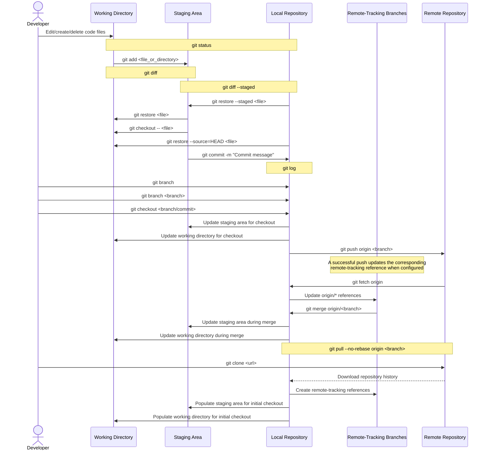

Understand Git's object model, references, working areas, repository initialization, and configuration hierarchy.

## Object model, references, and working areas

| Layer                              | Component                   | What it stores or represents                                                        |
| ---------------------------------- | --------------------------- | ----------------------------------------------------------------------------------- |
| Immutable objects (`.git/objects`) | **Blob**                    | Raw file contents (addressed by SHA-1 or SHA-256 content hash)                      |
| Immutable objects (`.git/objects`) | **Tree**                    | Directory listing mapping filenames and modes to blobs and subtrees                 |
| Immutable objects (`.git/objects`) | **Commit**                  | Root tree SHA, parent commit SHA(s), author/committer metadata, and message         |
| Mutable refs (`.git/refs`)         | **Branch** (`refs/heads/*`) | Movable pointer that advances automatically when you commit on it                   |
| Mutable refs (`.git/refs`)         | **Tag** (`refs/tags/*`)     | Fixed pointer to a commit or annotated tag object (typically a release)             |
| Mutable refs (`.git/refs`)         | **`HEAD`**                  | Symbolic pointer to the checked-out branch, or direct commit SHA in detached `HEAD` |
| Local areas                        | **Working tree**            | Checked-out files on disk that you edit (`git diff` compares working tree vs index) |
| Local areas                        | **Index (staging area)**    | Proposed next commit snapshot (`git diff --cached` compares index vs `HEAD`)        |
| Local areas                        | **`HEAD` snapshot**         | Last committed snapshot (`git diff HEAD` compares working tree vs `HEAD`)           |

### Data flow across Git areas

The following sequence diagram traces how commands move changes between the working directory, staging area, local repository, remote-tracking refs, and remote repository:



For staging and commit workflows, see [Staging and committing](/docs/cheatsheets/tooling/git/staging-and-committing/); for cryptographic verification, see [Commit signing](/docs/cheatsheets/tooling/git/commit-signing/).

## Initialize or clone a repository

Create a new repository in the current directory or clone an existing remote repository:

```bash
git init -b main
git clone https://github.com/OWNER/REPOSITORY.git
git status --short --branch
```

Replace `OWNER/REPOSITORY` with the target repository path.

- **`-b main`:** Sets the initial branch name explicitly (`init.defaultBranch` controls the fallback when `-b` is omitted).
- **Clone defaults:** `git clone` configures a remote named `origin` and checks out the remote's default branch unless you pass `-b BRANCH_NAME`.

## Configure identity and settings

Git reads configuration in increasing order of precedence: `--system` (all OS users) → `--global` (current user) → `--local` (current repo) → `--worktree` (when worktree config is enabled). Narrower scopes override broader ones.

Set and audit configuration values:

```bash
git config --global user.name "Ada Example"
git config --global user.email "ada@example.com"
git config --local user.email "ada-work@example.com"
git config --show-origin --get user.email
git config --list --show-origin
```

- **Identity caveat:** `user.name` and `user.email` are unverified commit labels; use an email address verified on your GitHub account for commit attribution, and configure [Commit signing](/docs/cheatsheets/tooling/git/commit-signing/) when cryptographic proof is required.

## Inspect current state, `HEAD`, and history

Run these commands to check where `HEAD` points and inspect recent commits:

```bash
git log --oneline --decorate --graph --all
git show HEAD
git branch --show-current    # Prints current branch name (empty in detached HEAD)
git rev-parse HEAD           # Prints full commit SHA of HEAD
git status
```

## Ignore untracked files

Add shared ignore patterns to `.gitignore` (use `.git/info/exclude` for local-only rules or `core.excludesFile` for user-wide rules):

```gitignore
.env
build/
*.log
```

Diagnose which ignore rule matches a file, stop tracking an already-committed file, or force-add an ignored path:

```bash
git check-ignore -v FILE_PATH
git rm --cached FILE_PATH     # Stop tracking file while keeping it on disk
git add -f FILE_PATH          # Deliberately stage an ignored file
```

Replace `FILE_PATH` with the target path.

## References

- [Git documentation: Data model (`gitdatamodel`)](https://git-scm.com/docs/gitdatamodel)
- [Git documentation: User manual](https://git-scm.com/docs/user-manual)
- [Git documentation: `git-init`](https://git-scm.com/docs/git-init)
- [Git documentation: `git-clone`](https://git-scm.com/docs/git-clone)
- [Git documentation: `git-config`](https://git-scm.com/docs/git-config)
- [Git documentation: `gitignore`](https://git-scm.com/docs/gitignore)
